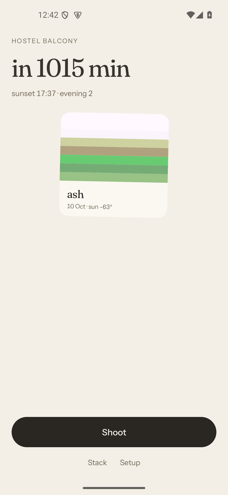
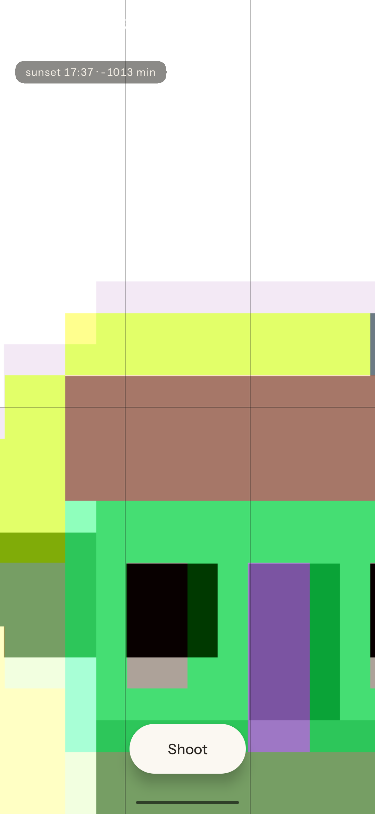
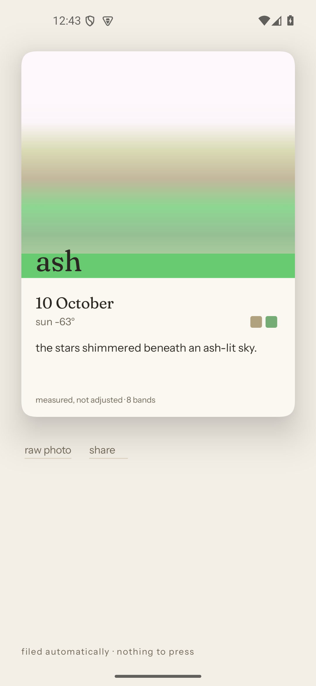
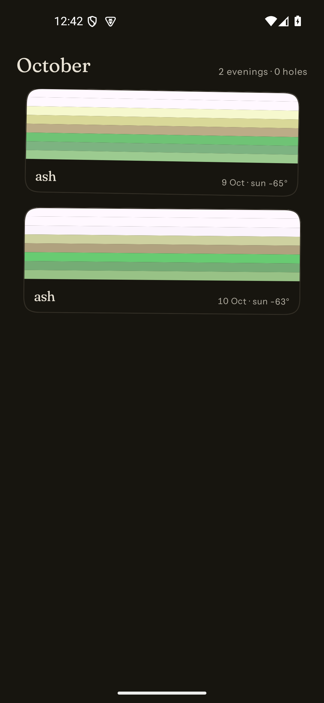
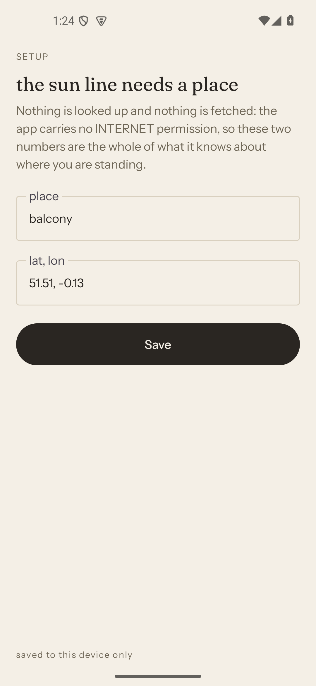
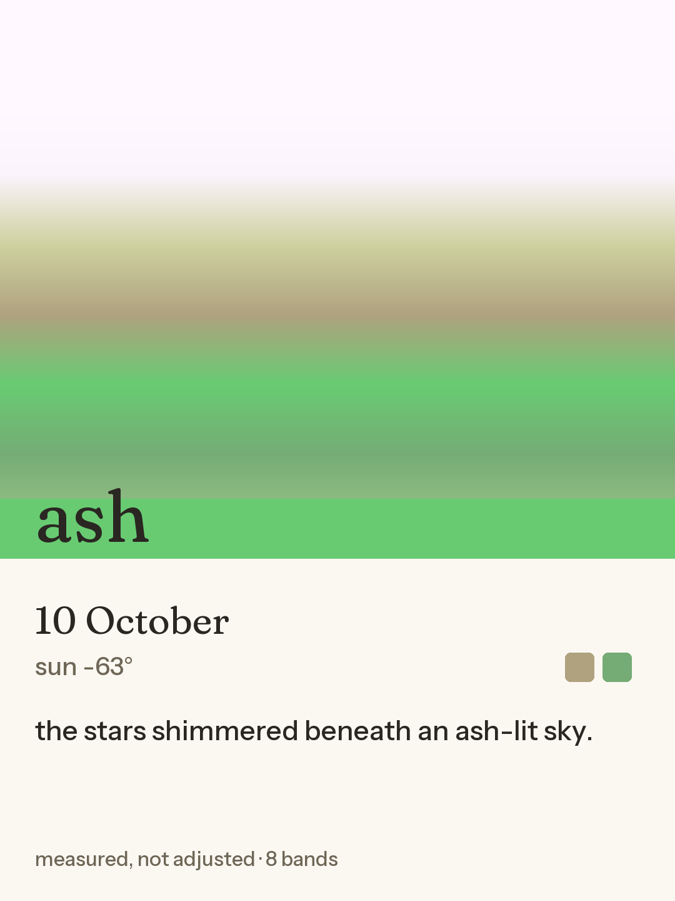
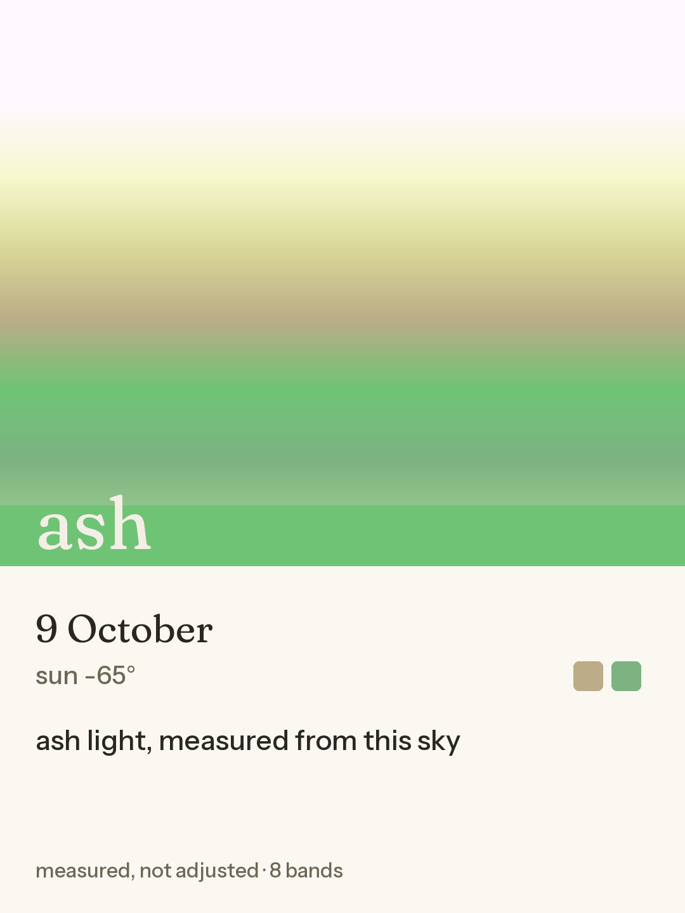

# Evenlight

*one balcony, one sky, one card an evening.*

You take one photo of the evening sky. The app reads eight horizontal colour bands off that photo, names the
evening by matching the most colourful band against a fixed list of 35 words, and files a card. Every evening you
shoot stacks day over day, with a visible gap for the evenings you did not shoot. An on-device language model may
write one line of prose about the colour that was already measured. It is not allowed to choose anything.

That last sentence is the whole project. I ran a 1B model on the inputs the app would actually hand it, before
writing any app code, found it was bad at picking and fine at phrasing, and moved every decision in the app out of
its reach. The measurement is in
[the model section](#the-model-and-the-measurement-that-demoted-it) below, and every number in this file traces to
something in the repository - or says out loud that it does not. `docs/dev-post.md` is the long version of the same
story.

## What is on screen

Five screens, and the app is `:app` plus a pure-Kotlin `:core`. The file paths below are relative to
`app/src/main/java/com/burry071/evenlight/`; the ones that start with `core/` are the same idea under
`core/src/main/kotlin/com/burry071/evenlight/`.



**Tonight.** One number: minutes until sunset at the place you typed, with the sunset time and tonight's evening
index under it, the latest card, and a shutter that is never disabled at any hour. `ui/TonightScreen.kt`,
`core/SunWindow.kt`.



**Shoot.** The camera, a framing guide, and a chip saying where you are relative to sunset.
`ui/ShootScreen.kt`, `ui/FramingGuide.kt`.



**Card.** The rendered card, plus `raw photo` and `share`. `ui/CardScreen.kt`, `card/CardRenderer.kt`.



**Stack.** Every evening, newest first, holes included. `ui/StackScreen.kt`, `ui/StackDays.kt`.



**Setup.** A name and two numbers. Nothing is looked up and nothing is fetched, because nothing can be.
`ui/SetupScreen.kt`, `data/Settings.kt`.

**Read the pixels before you read anything else in this file.** All five screens and both cards above come from the
emulator's synthetic camera scene, not from a sky. There is no real evening in this repository. The app has never
been pointed at a balcony, and there is deliberately no strip of cards here presented as a run of evenings.

## Try it in twenty seconds, without Android or the model

The band maths and the card layout have a second implementation in Python, so nobody has to install an app or
download a gigabyte to check the claim.

```bash
python tools/python/skycard.py photo.jpg -o card.png --print-json
```

It prints the eight bands, which band won, and the name, then writes a 1080x1440 card. Needs Python with Pillow
and nothing else. Timed as whole processes on my box, two runs each: 0.27 s and 0.33 s for a 128x96 fixture, 4.7 s
and 6.1 s for a 4032x3024 JPEG at 2 MB. That second file is a synthetic gradient with noise in it, not a photograph,
and the gap between its two runs is why both numbers are there instead of one.

The two implementations are tested against the same four PNG goldens in `fixtures/`, pinned by
`core/src/test/kotlin/com/burry071/evenlight/core/FixtureEquivalenceTest.kt` and mirrored by
`tools/python/test_skycard.py`, so agreement is transitive and neither language can drift without a failure:

```bash
python tools/python/test_skycard.py -v      # 13 tests
```

## The measurement is the code, not a description of it

If you want to argue about the number on a card, these are the lines that produce it.

A frame is resampled to 64 px wide with a hand-written half-pixel-centre bilinear pass, split into eight horizontal
bands, and each band is averaged per channel with round-half-up:

```kotlin
// core/src/main/kotlin/com/burry071/evenlight/core/BandSampler.kt
val dh = max(1, min(height, Pixels.roundHalfUp(height.toDouble() * dw / width)))
val small = bilinear(pixels, width, height, dw, dh)
```

The `min(height, ...)` clamp is load-bearing and has a fixture the size to prove it: `fixtures/sky_narrow.png` is
32x6, where the derived height would otherwise exceed the row count and the interpolator would invent rows that do
not exist. Every other fixture is at least 64 px wide, where the clamp is the identity.

The winning band is the largest spread between its own channels, ties going to the brighter band. The name is
nearest neighbour in RGB against 35 anchors, ties going to whichever word comes earlier in the list:

```kotlin
// core/src/main/kotlin/com/burry071/evenlight/core/Matcher.kt
/** Max chroma range; tie -> higher relative luminance; tie -> lowest index. Deterministic. */
fun winner(bands: List<Int>): Int
/** Euclidean RGB distance, unweighted. Ties keep the earlier vocabulary entry. */
fun nameFor(c: Int): String
```

The vocabulary is a list in source, not a config file, because a word that can be edited at runtime is a word that
can be invented:

```text
still  smothered  clearing  brassy  tarnished  milky  flint  ember  copper  chalk
slate  ash  wax  honey  bruised  waited  low  thin  wide  close
dusty  wet  salt  iron  paper  linen  wool  amber  smoke  held  lifted
sunken  gathering  fading  bright
```

`core/src/main/kotlin/com/burry071/evenlight/core/Vocabulary.kt` holds all 35 with their anchor hexes, and
`Vocabulary.size` is asserted to be 35 by `MatcherTest` under `core/src/test/kotlin/`. The card itself is pure
numbers in `core/CardGeometry.kt`: 1080x1440, a field that is a linear blend between neighbouring band centres, and
a strip carrying the name. That blend is the only permitted transformation of a measured colour.
`Pixels.relativeLuminance` is the sRGB linearisation, and it is also what decides whether the strip's text is paper
or ink.

## The model, and the measurement that demoted it

The probes ran before any product code: five designs, a 1B open-weight model on CPU, and the same eighteen calls on
the last two. The first four rows of the table ran on a desktop runtime; the fifth is the identical eighteen calls
against `Gemma3-1B-IT_multi-prefill-seq_q4_ekv4096.litertlm` on the emulator's CPU. The table is reproduced from
`docs/superpowers/specs/2026-10-07-evenlight-design.md` section 7, which is where it was recorded at the time.

| what I asked for | what came back |
|---|---|
| "name the evening, 2-3 words, no digits" | obeyed the format, copied nouns out of my input |
| same, plus a ban list, exactly 2 words, temperature 1.0 | the same echo failure |
| "choose from exactly these words" (the real 35-word vocabulary) | **0/6 on-list** |
| "choose one of these three" | **on-list 17/18**, **stable across reordering 1/6** |
| the identical 18 calls on-device, CPU | **on-list 18/18, single-line 18/18, stable 1/6** |

On-device, 18 out of 18 obeyed the shape they were asked for. One out of six kept the same answer when I shuffled the
order of the three choices, and that 1/6 reproduced on a second independent runtime, so it is a model limit and not a
quantisation artifact or a bug in my harness. That is the finding that decided the architecture: the matcher owns
every choice, and the model writes one line of 4-8 words from a name it was handed.

The prompt and the rules the reply has to clear are in the repo, not described here:
`app/src/main/java/com/burry071/evenlight/wording/Wording.kt` and
`core/src/main/kotlin/com/burry071/evenlight/core/Verifier.kt`. The gate is an allowlist - a line may contain
lowercase letters, spaces, and `. , - '` - and it became one the hard way.

### The measured failure rate, in two rows that must not be blended

Nineteen shots through the installed app with the weights present and the engine warm. The verifier changed
halfway through, so this is two experiments and the rows are separate. All nineteen records are in
`docs/data/wording-sample/`, and `docs/data/wording-sample/PROVENANCE.md` has a nine-line script that recounts
them; I ran it, and it prints 19 shots, 12 answered, 8 accepted, 4 rejected, 7 silent.

| gate | shots | answered | silent | rejected | accepted | accepted wrongly |
|---|---|---|---|---|---|---|
| denylist, the first 13 | 13 | 6 | 7 | 1 | 5 | 1 |
| allowlist, the last 6 | 6 | 6 | 0 | 3 | 3 | 0 |
| both, for arithmetic only | 19 | 12 | 7 | 4 | 8 | 1 |

Blending those rows is the dishonest move, and it is tempting. The one wrongly accepted line is a miss the shipped
gate cannot make, so it does not belong in the shipped gate's denominator; and a six-shot row cannot carry a
rejection rate at all, because "3 of 6 rejected" reads as "the new gate is worse" and means nothing.

The wrongly accepted line, verbatim from `docs/data/wording-sample/2026-10-09-attempt-13.json`:

```text
the **ash** sky glowed softly as dusk fell.
```

The old gate banned `#`, `<`, `{`, `(` by name. It did not ban `*`. The card rendered literal markdown asterisks
under the name `ash`, and the record said everything was fine, because the line had passed. A denylist has to be
right every time; a 1B model only has to be creative once.

You will not find a `wording_rejected / wording_total` ratio in this file, and that is deliberate:
`Store.wordingTotal()` counts every record on the device, including the evenings where the model was never
consulted, so it is the wrong denominator for a gate. The gate's rate is rejections over the answers it was
actually given, and `applyWording`'s comment in
`app/src/main/java/com/burry071/evenlight/wording/Wording.kt` says so.

### What the seven silences were, and were not

They were not slowness, and I said they were. Once the seven had their own provenance value, their timestamps told
the rest: the seven silent shots are exactly the seven fired 5-13 seconds after their neighbour. Every shot spaced
22 s or more produced an answer, on the same build with the same weights. The reason is the measured cost of a
call: the pre-model record write lands 0.13-2.8 s after the capture tap, and the model's rewrite lands 11-21 s
after that, so a second shot at twelve seconds arrives while the first call is still inside the engine. One engine,
two callers.

Two things follow, and both are in the open rather than in a footnote. `withTimeoutOrNull` around a blocking native
call bounds nothing: measured on the same emulator, a call that ran 10.5 s still delivered its line past the 10 s
marker. And the fix that came out of it - the close guard in `EngineHolder` is held across the whole native call -
is **reasoned code, not covered code**: no JVM test constructs `EngineHolder` at all, so nothing here proves that
guard is strong. It is documented at the declaration in
`app/src/main/java/com/burry071/evenlight/wording/EngineHolder.kt`, and this paragraph is the other half of that.

The honest half of the honest half: I fired those shots in a burst because I was testing a code path, not living
with an app. One evening a day is the cadence this is for, and at that cadence these records say 12 answered out of
12 spaced shots, not 6 out of 13. Both numbers are in the table.

### The one picture that explains the design



The model wrote `the stars shimmered beneath an ash-lit sky.` There are no stars in that scene and the record
measures none; the only facts in this pipeline are eight colours and one computed altitude. The gate checks form,
not truth, and it can only check form. So look at what the model could not do: the name `ash`, the eight bands,
their order, and the green of that strip are all measurements. If the model had been allowed to choose any of
them, "stars" would have become a plausible-looking lie on a card that claims to be a measurement.

The other card in the repo is the evening before, and it is the gate working. `2026-10-09`'s last shot was rejected,
so that date's card carries the template line the fallback writes:



## The costs, before you discover them

All timings in this section are from an x86_64 API-35 emulator (1080x2340 @ 440 dpi, 3,048,052 kB `MemTotal`).
**The target device is unmeasured.** I am not going to quote a phone I did not read, and I am not going to repeat
the number I remembered about it instead.

- The debug APK is 61,231,992 bytes (58.4 MiB) and contains zero model weights. That is the LiteRT-LM library's
  native code, compiled for four ABIs.
- The model file is 584,417,280 bytes and it is not in this repository: GitHub's hard per-file limit is 100 MB, so
  it cannot be. `models/GET_MODEL.md` has the URL, the filename, the byte size, the sha256, and the one thing you
  have to do in a browser yourself.
- Real on-disk cost is **1,092,957,056 bytes ≈ 1.02 GiB**, not 557 MiB, because the engine writes a
  508,539,776-byte XNNPack cache beside the weights. Measured on the emulator.
- Model init 4,566 ms, peak RSS during a call 1,269 MB, about 1.2 s per line in isolation, and roughly 132 MB of
  free RAM with the model resident and the low-memory killer active. All emulator numbers.
- The app is complete without the model. No weights, no download, no failure: the card uses the template line and
  the record says `wording_source: "none"`.
- Two variable fonts are bundled, 554 KB, with their OFL texts in `LICENSES/`. Android cannot address a weight axis
  through the API people expect, so the variation is pinned in `<font-family>` XML under `app/src/main/res/font/`
  and loaded through `ResourcesCompat`.
- Test counts on this host: 87 Kotlin core tests, 39 app tests, 13 Python tests.

## Permissions

One line, in `app/src/main/AndroidManifest.xml`:

```xml
<uses-permission android:name="android.permission.CAMERA" />
```

That is the entire runtime permission set. There is no `INTERNET` permission, and no network code to want one: the
sun line is a NOAA approximation in `core/SunWindow.kt`, computed from the two numbers you type in Setup, and
the only thing that ever leaves the app is a card you hand to another app yourself through a `FileProvider` with a
per-URI read-only grant.

`app/src/test/java/com/burry071/evenlight/ManifestTest.kt` asserts the set parsed out of the manifest equals
`{CAMERA}`, asserts `android.permission.INTERNET` never appears in it, and asserts the whole `FileProvider` chain
exists so that `raw photo` and `share` do not crash on a device. Its limit, stated here rather than found later:
that test reads the **source** manifest, not the merged artifact, so a dependency that declared `INTERNET` in its
own manifest would merge in without tripping it. `app/build.gradle.kts` declares the source file as a test input so
the guard at least re-runs when someone edits it. The merged manifest also gains
`com.burry071.evenlight.DYNAMIC_RECEIVER_NOT_EXPORTED_PERMISSION` from AndroidX, which is a permission the app
declares for itself, not one it asks you to grant.

## The record, and its holes

One evening is twelve fields, written before the card is rendered so that no later failure can lose the
observation:

```kotlin
// core/src/main/kotlin/com/burry071/evenlight/core/EveningRecord.kt
date, shutter, bandsHex, winnerIndex, name, sunAltitudeDeg, meanLuminance,
wording, wordingSource, wordingRejected, attempt, clockSuspect
```

`wordingSource` is one of exactly four values - `"model"`, `"template"`, `"no-answer"`, `"none"` - and the two
"nothing came back" values exist because conflating them was a real bug: seven evenings were filed as `"none"`
("no model on this device") while the weights were present and warm, which made any failure rate built on that
field uncomputable, and wrong in the flattering direction. Files live under
`files/evenlight/{records,cards,raw}/` per `app/src/main/java/com/burry071/evenlight/data/Store.kt`, one record per
attempt, so a second shot on the same evening does not overwrite the first.

The holes, stated exactly:

- **A rejected line is counted and then thrown away.** The record stores `wording_rejected: true` and the template
  line that replaced it, never the model's text or which rule rejected it. Two of the six allowlist answers are
  therefore unexplainable from the published data. Fixing it needs a new field on `EveningRecord`, and `:core` is
  frozen for this entry.
- **`clock_suspect` catches less than its name suggests.** It compares two reads of one wall clock around a shutter
  press, so it catches an NTP correction that lands during the capture. It cannot catch a clock rewound before the
  app started, and a phone that dozed between the two reads trips it for a reason that is not a clock fault at all.
  The stack is ordered by the record's filename, which is built from that same wall clock, so a rewound clock
  really does move a row and nothing notices.
- **The sun number is computed, not measured.** `sun_altitude_deg` comes from the date, the time, and the position
  you typed. It is honest geometry and it is not a reading of the sky.
- **Low light is recorded, not refused.** `mean_luminance` goes into every record and nothing is dropped for being
  dark, so a dim sky produces a confident card.
- **Nothing in a record says where you were.** No photo, no coordinates, no place name: those live in
  `settings.json` on the device, which is not committed and is not part of the sample.
- **The visible gaps are not visible in any image here.** The stack screenshot says `2 evenings · 0 holes`, because
  the two synthetic evenings are on consecutive days. The hole logic is `ui/StackDays.kt` and it is covered by
  `StackDaysTest`, not by a picture.
- **There is no real evening.** The first sky this app measures is the one outside my window. If I do not shoot it,
  the stack will show that too, which is the part of the design that survives my own laziness.

## Building it

You need JDK 17 or newer, an Android SDK with API 35, and Gradle 8.8. `gradle/wrapper` is not committed in this
repository - a known gap I did not get to - so there is no `./gradlew`; use your own Gradle.

```bash
export ANDROID_HOME=/path/to/Android/Sdk     # or create local.properties with sdk.dir=...
gradle :app:assembleDebug                    # first run needs network for dependencies
gradle :core:test :app:testDebugUnitTest     # 87 + 39 tests
```

`local.properties` is gitignored on purpose, because it holds a machine-specific SDK path. Both test tasks and the
Python suite pass with no model file anywhere on the machine, which is the proof that the optional-model claim is
structural rather than a setting.

## Licence

MIT for the code, in `LICENSE`. The weights are not redistributed and cannot be. The two bundled fonts are SIL OFL
1.1 works whose texts sit, untouched, in `LICENSES/` - a directory and a file with confusingly similar names, doing
different jobs.

## Where this is weak

I would rather list it than have you find it. The model answered 12 of 19 shots and one of the eight accepted lines
should not have been accepted; the shipped gate's own row is six shots, which is too small to publish a rate from.
The close guard around the native engine has no test behind it. The sample is nineteen shots of one synthetic scene,
so nothing here is a claim about weather, locations, or evenings. Every timing is x86_64 and the device I will
actually use is unmeasured. The Gradle wrapper is missing. And the app has never photographed a real sky.
